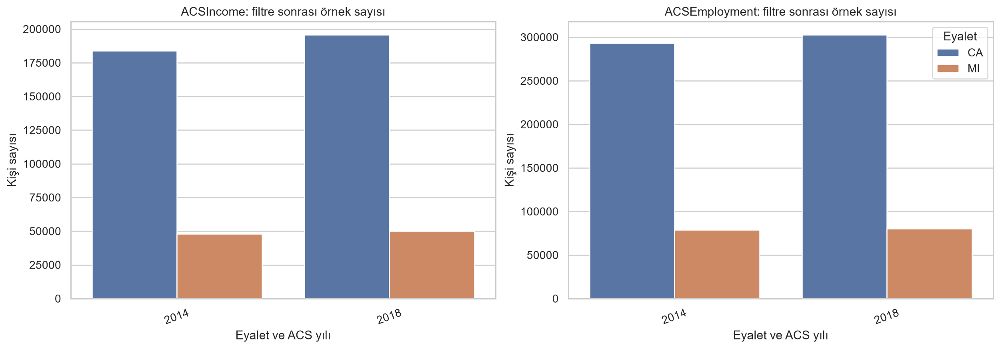
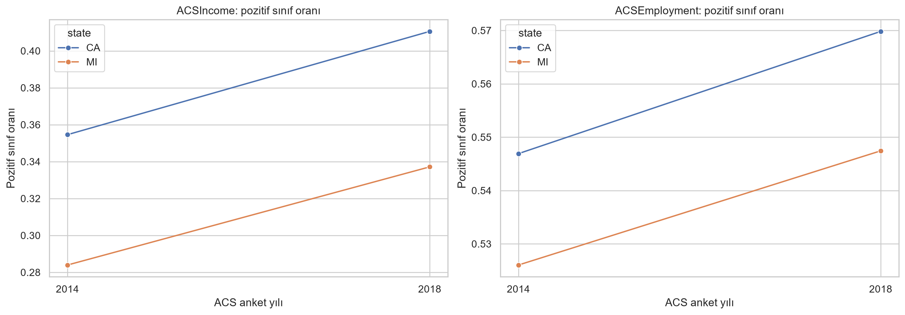
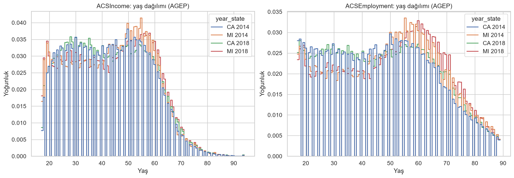
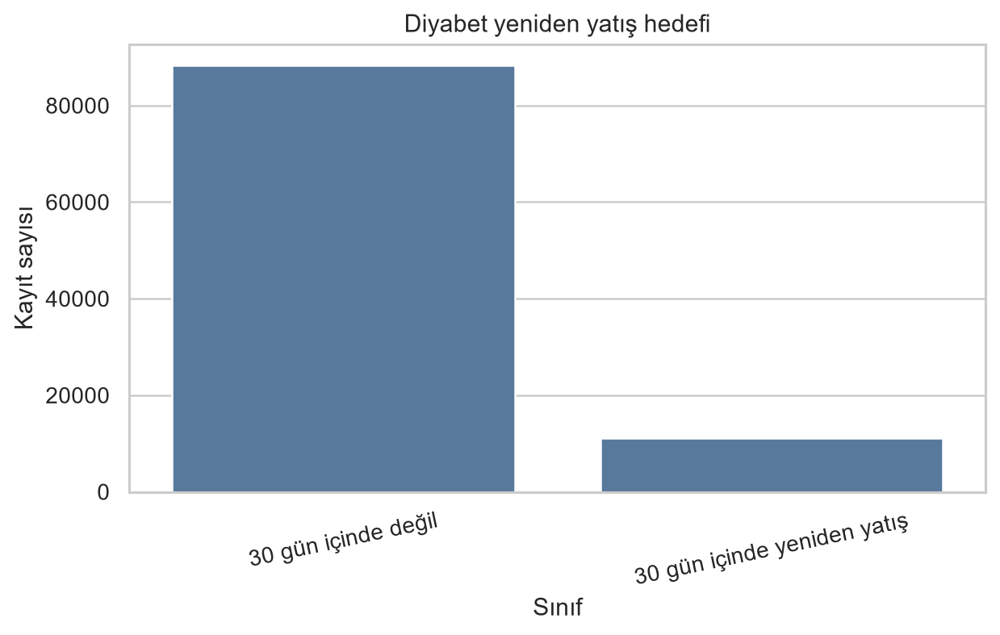
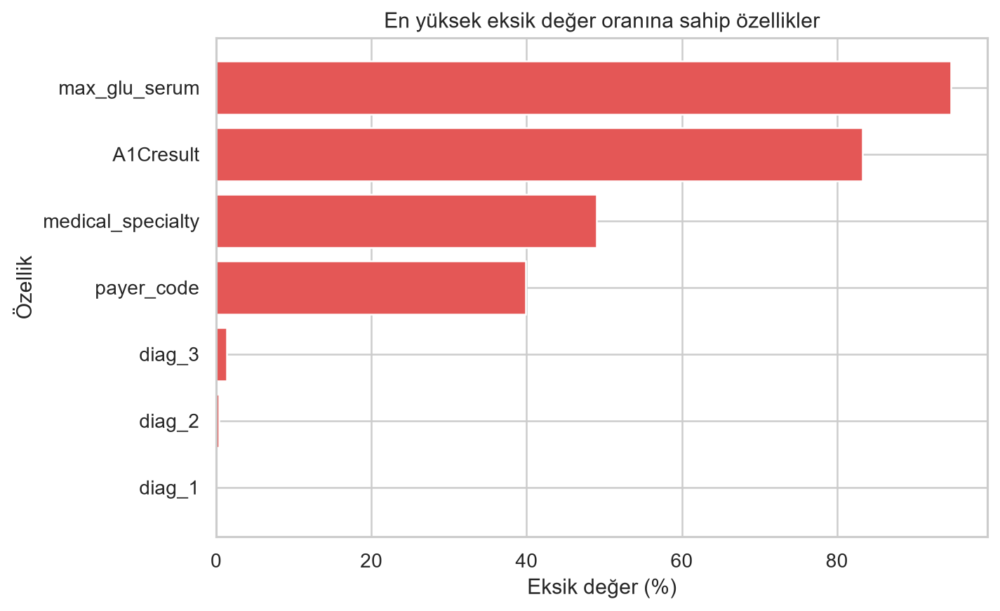
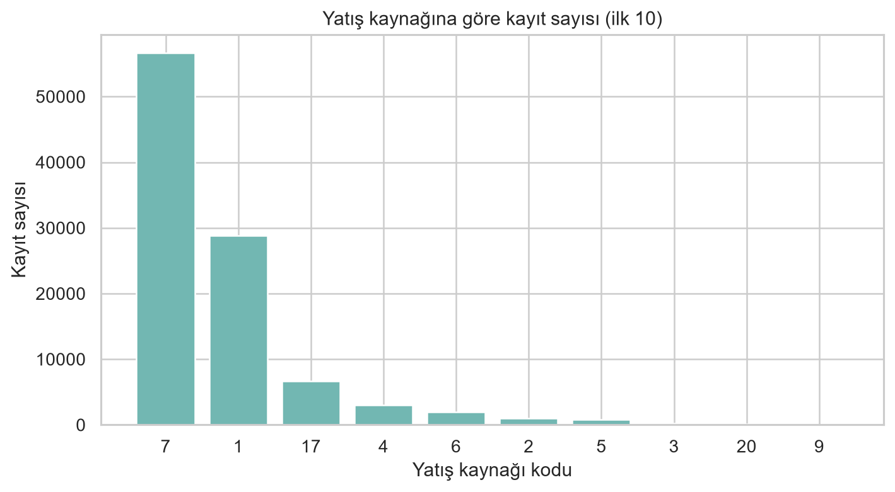

# Faz 1 İlerleme Raporu

**Proje:** Tablosal Veride Dağılım Kaymasına Duyarlı Güvenilirlik İzleme
**Grup:** Elif Su Baydarlı (241230017), Zehra Akgül (241230036)

## 1. Amaç ve problem

Dağıtım sonrasında veri dağılımı değişebilir. Gerçek etiketler gecikmeli geldiğinde modelin performansını hemen ölçmek mümkün olmayabilir. Bu projede tablosal ikili sınıflandırma modellerinin performansındaki bozulmanın; güven, kalibrasyon, girdi kayması ve açıklama değişimi gibi etiketsiz sinyallerle ne kadar erken ve ne kadar az yanlış alarm vererek izlenebileceği araştırılacaktır.

Folktables ACSIncome ve ACSEmployment görevleri ile hastaneye yeniden yatış görevi ikili sınıflandırma problemleridir. Çalışmanın ana problemi, bu görevlerde eğitilecek modellerin performans düşüşünü dağılım kayması altında izlemektir. Bu fazda model eğitilmemiş, sonuç üretilmemiştir.

## 2. Veri setleri ve görevler

Proje kapsamında üç temel görev seçilmiştir. İlk iki görev, ABD Nüfus Sayımı Bürosu ACS PUMS mikroverisinden Folktables ile oluşturulan görevlerdir. Üçüncü görev, UCI Diabetes 130-US Hospitals verisinden oluşturulan yeniden yatış sınıflandırmasıdır. Veri setleri yapay olarak üretilmemiş olup gerçek gözlemlere dayanmaktadır.

| Görev ve kaynak | Hedef | Veri sürümü ve bağlam | Ham kayıt | Filtre sonrası | Özellik |
|---|---|---|---:|---:|---:|
| ACSIncome, Folktables | Yıllık kişisel gelir > 50.000 USD | Folktables 0.0.12; 2014 CA | 372.553 | 183.941 | 10 |
| ACSIncome, Folktables | Aynı | 2014 MI | 98.180 | 47.888 | 10 |
| ACSIncome, Folktables | Aynı | 2018 CA | 378.817 | 195.665 | 10 |
| ACSIncome, Folktables | Aynı | 2018 MI | 99.419 | 50.008 | 10 |
| ACSEmploymentFiltered, Folktables | Çalışıyor (`ESR == 1`) | Folktables 0.0.12; 2014 CA | 372.553 | 292.975 | 17 |
| ACSEmploymentFiltered, Folktables | Aynı | 2014 MI | 98.180 | 78.691 | 17 |
| ACSEmploymentFiltered, Folktables | Aynı | 2018 CA | 378.817 | 302.640 | 17 |
| ACSEmploymentFiltered, Folktables | Aynı | 2018 MI | 99.419 | 80.126 | 17 |
| Diabetes 130-US Hospitals, UCI 296 | Hastaneden çıktıktan sonraki 30 gün içinde yeniden yatış | 1999–2008; TableShift görevindeki ırk bilgisi filtresi | 101.766 | 99.493 | 45 model girdisi |

Folktables görevleri sayısal ve kategorik özellikleri birlikte içerir. ACSIncome’da 2 sayısal ve 8 kategorik; ACSEmploymentFiltered’da 1 sayısal ve 16 kategorik özellik vardır. Folktables görev tanımları ve ACS PUMS erişimi kaynakçada verilmiştir [1, 9, 13].

UCI verisinde 50 sütun bulunur. `encounter_id` ve `patient_nbr` kimlik alanları, `readmitted` hedefi ve `admission_source_id` alanı model girdisi olarak kullanılmayacaktır. `admission_source_id` alanı dış alanı tanımlamak için saklanacaktır. Eksikliği %96,93 olan `weight` ilk model hattından çıkarılmıştır. Böylece 45 model girdisi kalmıştır. Ham tabloda 17 yatış kaynağı kodu gözlenmiştir; TableShift’in tanımladığı acil servis alanı kodu 7’dir [2, 12]. Veri UCI sayfasından erişilebilir; indirme 7 Kasım 2026’da yapılmıştır [1].

### Sınıf dağılımı

ACSIncome pozitif sınıfı CA’da 2014’te %35,46, 2018’de %41,06; MI’da sırasıyla %28,40 ve %33,72’dir. ACSEmploymentFiltered pozitif sınıfı CA’da %54,69’dan %56,98’e, MI’da %52,60’tan %54,75’e değişmiştir. ACS örnekleri etiketlidir. Oranlar kişi ağırlığı `PWGTP` uygulanmadan hesaplanmıştır ve nüfus tahmini olarak yorumlanmamalıdır.

UCI verisinde ırk bilgisi eksik 2.273 kayıt çıkarıldıktan sonra `readmitted` etiketleri `<30`: 11.169, `>30`: 35.007 ve `NO`: 53.317’dir. Projede pozitif sınıf `<30`, negatif sınıf `>30` veya `NO` olarak tanımlanmıştır. Böylece 11.169 pozitif ve 88.324 negatif kayıt elde edilmiştir. Veri 69.668 benzersiz hasta içerir; hasta başına birden fazla yatış kaydı bulunduğundan bölme hasta kimliğine göre yapılacaktır.

## 3. Eksik değer ve ön işleme

- ACSIncome görevinde incelenen özelliklerde eksik değer bulunmamıştır.
- ACSEmploymentFiltered’da hücrelerin yaklaşık %7’si eksiktir. `ESP` sütunundaki eksiklik %98,42–%98,62; `GCL` sütunundaki eksiklik %18,47–%22,22 aralığındadır. `ESP` ilk model hattından çıkarılacak, etkisi ayrıca incelenecektir.
- UCI dosyasında `?` eksik değer olarak okunmuştur. Irk bilgisi eksik 2.273 kayıt, TableShift’in yayımladığı filtreyle tutarlı biçimde çıkarılmıştır [12]. Model girdileri arasındaki en yüksek kalan eksiklik `max_glu_serum` sütununda %94,68’dir. `weight` sütunu %96,93 eksik olduğu için ilk model girdilerinde tutulmayacaktır.
- Folktables ön işleme hattında `-1` eksik değer olarak ele alınacaktır. Sayısal alanlar eğitim verisindeki medyanla doldurulup ölçeklenecek; kategorik alanlar eğitim verisindeki en sık değerle doldurulup one-hot kodlanacaktır.
- UCI ön işleme hattında sayısal alanlar medyanla doldurulup ölçeklenecek; kategorik alanlardaki eksiklik ayrı bir `Eksik` kategorisi olarak korunup one-hot kodlanacaktır. Kimlik alanları girdi olmayacaktır.
- Dönüştürücüler yalnızca eğitim bölümünde fit edilecek; doğrulama ve test verisine aynı dönüşümler uygulanacaktır. Folktables için 2014 CA eğitim, 2018 CA zamansal değerlendirme ve MI coğrafi değerlendirme olarak planlanmıştır. UCI verisinde hasta kimlikleri eğitim ve değerlendirme bölümleri arasında ayrılacak; acil servis yatış kaynağı ayrı bir dış alan olarak kullanılacaktır. Bölme ve rastgelelik tohumları modelleme öncesinde sabitlenecektir.

Ön işleme uygulamaları [preprocessing.py](../src/data/preprocessing.py), ACS veri keşfi [phase1_eda.py](../src/data/phase1_eda.py), UCI veri keşfi [phase1_readmission_eda.py](../src/data/phase1_readmission_eda.py) dosyalarındadır.

## 4. Keşif analizi ve görseller

ACS örnek sayıları, sınıf oranları ve yaş dağılımları ile UCI sınıf dağılımı, eksik değer oranları ve yatış kaynağı dağılımı aşağıda verilmiştir.

ACS sınıf oranları yıl ve eyalet bağlamlarına göre farklıdır; bu tek başına model başarımının düştüğünü göstermez. UCI verisindeki tekrarlı hasta kayıtları bağımsız gözlem varsayımını etkileyebilir; bu nedenle rastgele satır bazlı bölme kullanılmayacaktır. Eksikliği yüksek UCI ölçüm alanlarının modele katkısı sonraki aşamada ayrı değerlendirilecektir.

## 5. Literatür taraması

### UCI yeniden yatış görevi

Aşağıdaki çalışmalar aynı UCI Diabetes 130-US Hospitals verisini diyabet hastalarında hastaneye yeniden yatış sınıflandırması veya bu sonucun analizinde kullanmıştır. Hedef tanımı, filtreleme ve bölme yöntemleri çalışmadan çalışmaya değiştiğinden yayımlanan metrikler doğrudan karşılaştırılabilir değildir.

| Kaynak | Yöntem ve veri kullanımı | Bu projeyle ilişkisi |
|---|---|---|
| Strack et al. (2014) [2] | UCI veri kaynağındaki klinik kayıtları inceleyerek HbA1c ölçümü ile yeniden yatış arasındaki ilişkileri değerlendirmiştir. | Veri kaynağı ve klinik değişkenlerin tanımı için temel çalışmadır. |
| Alloghani et al. (2019) [3] | UCI verisinden 78.363 diyabetli kaydı ve 18 özelliği kullanmış; LDA, Random Forest, kNN, Naive Bayes, J48 ve SVM uygulamıştır. | Aynı veri üzerinde farklı sınıflandırıcıları ve özellikleri incelemiştir. |
| Cui et al. (2018) [4] | 8.756 kayıtta genetik algoritmayla ayarlanan SVM, SMOTE ve özellik seçimi kullanmıştır; beş katlı doğrulama bildirmiştir. | Sınıf dengesizliği ve özellik seçiminin önemini gösterir. |
| Shang et al. (2021) [5] | 100.244 kayıt ve 23 risk özelliğiyle Random Forest, Naive Bayes ve karar ağacı topluluğunu karşılaştırmıştır; RF en yüksek AUC’yi vermiştir. | 30 günlük hedef tanımına yakın bir sınıflandırma çalışmasıdır. |
| Cuong ve Wang (2021) [6] | Lojistik Regresyon, ANN, Naive Bayes, SVM ve XGBoost’u rastgele aramayla karşılaştırmış; XGBoost’u en başarılı yöntem olarak raporlamıştır. | Model ve metrik seçiminde karşılaştırma noktası sağlar. |
| Liu et al. (2024) [7] | 11 yöntem, Grey Wolf Optimizer ile özellik seçimi, SMOTE ve grup bazlı çapraz doğrulama kullanmıştır; RF ve XGBoost’u öne çıkarmıştır. | Grup bazlı bölmenin ve sınıf dengesizliğini ele almanın gereğini destekler. |
| Emi-Johnson et al. (2025) [8] | Lojistik Regresyon, RF, XGBoost ve derin sinir ağı kullanmış; AUC-ROC değerlerini sırasıyla 0,642, 0,630, 0,667 ve 0,579 bildirmiştir. | Aynı görevde farklı model aileleri ile metriklerin karşılaştırılmasına örnektir. |

### Dağılım kayması ve performans izleme

Ding et al. [9] Folktables ACSIncome ve ACSEmployment görevlerini, yıllar ve eyaletler arasında karşılaştırılabilir veri görevleri olarak tanımlamıştır. Amoukou et al. [10] Folktables gelir sınıflandırmasında coğrafi ve zamansal değişimi kullanmış; etiketsiz sırayla izleme için hata tahmincisi ve nicelik tabanlı alarm yöntemi önermiştir. Çalışmalarında nicelik tabanlı yöntemin güç değeri 0,48 ve yanlış keşif oranı 0,019; ortalama tabanlı yöntemin değerleri sırasıyla 0,01 ve 0,19 olarak raporlanmıştır. Białek et al. [11] ABD nüfus sayımı verilerinden oluşturulan 900’den fazla model-veri birleşiminde etiketsiz performans tahmini için PAPE yöntemini incelemiştir. Gardner et al. [12] TableShift içinde 15 tablosal sınıflandırma görevi ve alan kayması tanımlamış; UCI Hospital Readmission görevini de bu benchmarka dahil etmiştir.

Bu başlangıç taraması, UCI yeniden yatış görevi için aynı veri kaynağını kullanan yedi çalışmayı; dağılım kayması ve etiketsiz performans izleme için de ilgili çalışmaları kapsar. Hedef, filtre ve bölme farkları nedeniyle yayımlanan metrikler doğrudan kıyaslanmamalıdır. Kaynakların kapsadığı yayınlar üzerinden tek bir ortak deney protokolü belirlenmemiştir.

## 6. Seçilen modeller ve değerlendirme planı

| Model | Kullanım amacı | Veri türüne uygunluk |
|---|---|---|
| Lojistik Regresyon | Yorumlanabilir başlangıç modeli | Uygun |
| Random Forest | Doğrusal olmayan ilişkiler ve etkileşimler için ağaç topluluğu | Uygun |
| XGBoost | Karışık tablosal özelliklerde karşılaştırma modeli | Uygun |
| 1B CNN | Tablo sütunlarına 1B evrişim uygulayan kontrol modeli | Düşük uygunluk; sütun sırası doğal bir komşuluk ilişkisi oluşturmaz |

Yönergedeki 3–5 yöntem aralığı için dört mimari seçilmiştir: Lojistik Regresyon, Random Forest ve XGBoost tablosal veriye uygun karşılaştırma modelleridir; 1B CNN ise sütun sırasının yapay komşuluk varsayımını test eden düşük uygunluklu kontrol modelidir. Model eğitimi Faz 2’de yapılacaktır. Mimari tanımları `src/evaluation/model_architectures.py` dosyasındadır.

Sonraki aşamada modeller Accuracy, Precision, Recall, Dengeli F1, ROC-AUC ve PR-AUC metrikleriyle değerlendirilecektir. Olasılık kalibrasyonu Brier skoru ve ECE (Beklenen Kalibrasyon Hatası) ile ölçülecektir. Etiketsiz izleme sinyallerinin erken uyarı başarısı; yanlış alarm oranı, tespit gücü ve gecikme metrikleri üzerinden analiz edilecektir.

## 7. Faz 1 Özeti ve Sonraki Adımlar

Faz 1 kapsamında belirlenen üç veri görevi (ACSIncome, ACSEmploymentFiltered ve UCI Diabetes Readmission) incelenmiş, resmi bağlantıları doğrulanmış, sınıf dağılımları ve eksik değer analizleri tamamlanmıştır. Veri sızıntısını önleyen ön işleme hattı kurulmuş ve karşılaştırılacak model mimarileri netleştirilmiştir.

Sonraki aşamada (Faz 2):
1. Belirlenen modellerin referans eğitim verileri üzerinde eğitimi ve hiperparametre doğrulaması yapılacaktır.
2. Kontrollü dağılım kayması senaryoları (özellik kayması, gürültü ve eksik veri) simüle edilecektir.
3. Etiketsiz güvenilirlik sinyallerinin model çöküşünü ne kadar erken ve ne kadar az yanlış alarmla yakaladığı ölçülecektir.

## Kaynakça

1. Clore, J., Cios, K., DeShazo, J., & Strack, B. (2014). *Diabetes 130-US Hospitals for Years 1999-2008* [Veri seti]. UCI Machine Learning Repository. https://doi.org/10.24432/C5230J. Veri: https://archive.ics.uci.edu/dataset/296/diabetes+130-us+hospitals+for+years+1999-2008
2. Strack, B. et al. (2014). Impact of HbA1c measurement on hospital readmission rates: Analysis of 70,000 clinical database patient records. *BioMed Research International*, 2014, 781670. https://doi.org/10.1155/2014/781670
3. Alloghani, M. et al. (2019). Implementation of machine learning algorithms to create diabetic patient re-admission profiles. *BMC Medical Informatics and Decision Making*, 19(Suppl 9), 253. https://doi.org/10.1186/s12911-019-0990-x
4. Cui, S., Wang, D., Wang, Y. et al. (2018). An improved support vector machine-based diabetic readmission prediction. *Computer Methods and Programs in Biomedicine*, 166, 123–135. https://doi.org/10.1016/j.cmpb.2018.10.012
5. Shang, Y. et al. (2021). The 30-days hospital readmission risk in diabetic patients: Predictive modeling with machine learning classifiers. *BMC Medical Informatics and Decision Making*, 21, 57. https://doi.org/10.1186/s12911-021-01423-y
6. Cuong, L. D. P., & Wang, D. (2021). A comparison of machine learning methods to predict hospital readmission of diabetic patient. *Studies of Applied Economics*, 39(4). https://doi.org/10.25115/eea.v39i4.4475
7. Liu, V. B., Sue, L. Y., & Wu, Y. (2024). Comparison of machine learning models for predicting 30-day readmission rates for patients with diabetes. *Journal of Medical Artificial Intelligence*, 7, 23. https://doi.org/10.21037/jmai-24-70
8. Emi-Johnson, O. G., & Nkrumah, K. J. (2025). Predicting 30-day hospital readmission in patients with diabetes using machine learning on electronic health record data. *Cureus*, 17(4), e82437. https://doi.org/10.7759/cureus.82437
9. Ding, F., Hardt, M., Miller, J., & Schmidt, L. (2021). Retiring Adult: New datasets for fair machine learning. *Advances in Neural Information Processing Systems*, 34. https://doi.org/10.48550/arXiv.2108.04884. Folktables: https://github.com/socialfoundations/folktables
10. Amoukou, S. I. et al. (2024). Sequential harmful shift detection without labels. *Advances in Neural Information Processing Systems*, 38th Conference. https://doi.org/10.52202/079017-4107
11. Białek, J. et al. (2025). Estimating model performance under covariate shift without labels. *Advances in Neural Information Processing Systems*, 38. https://doi.org/10.52202/085713-5379
12. Gardner, J., Popovic, Z., & Schmidt, L. (2023). Benchmarking distribution shift in tabular data with TableShift. *Advances in Neural Information Processing Systems*, 36. https://doi.org/10.52202/075280-2324. TableShift: https://github.com/mlfoundations/tableshift
13. U.S. Census Bureau. American Community Survey Public Use Microdata Sample (ACS PUMS). https://www.census.gov/programs-surveys/acs/microdata.html

