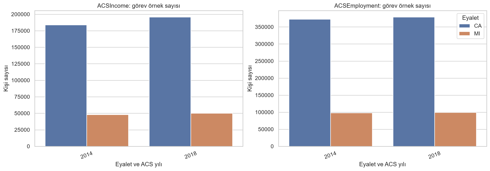
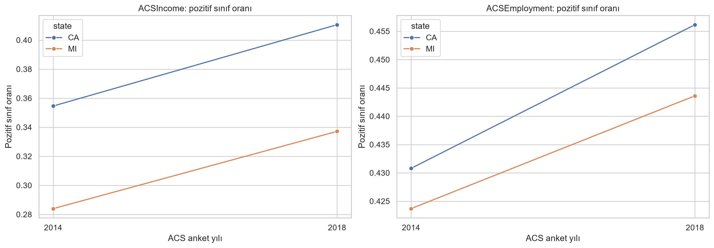
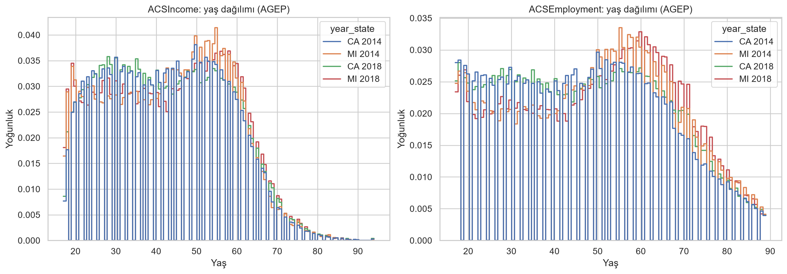
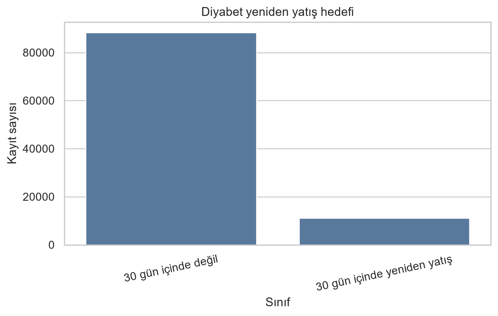
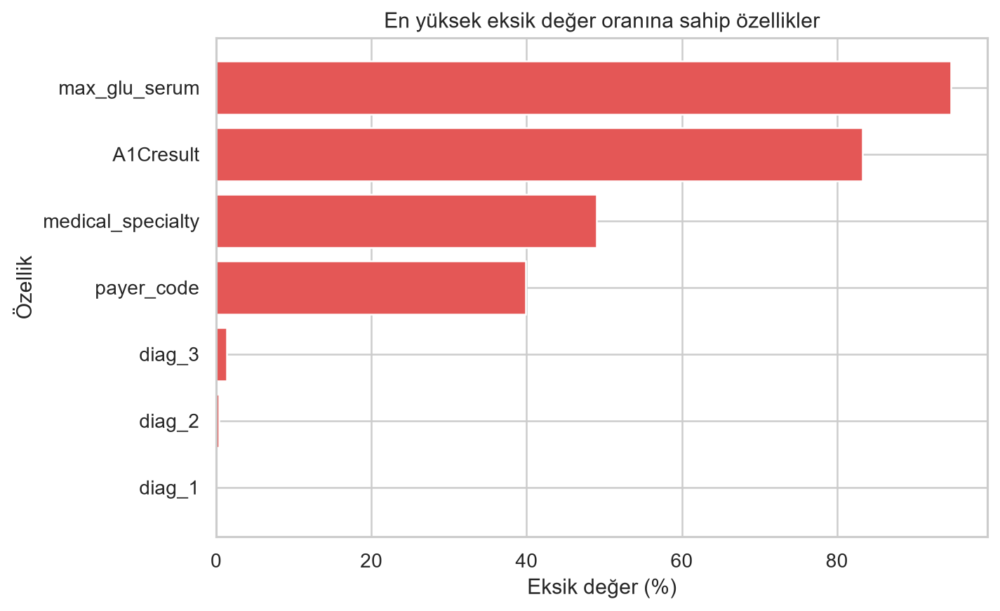
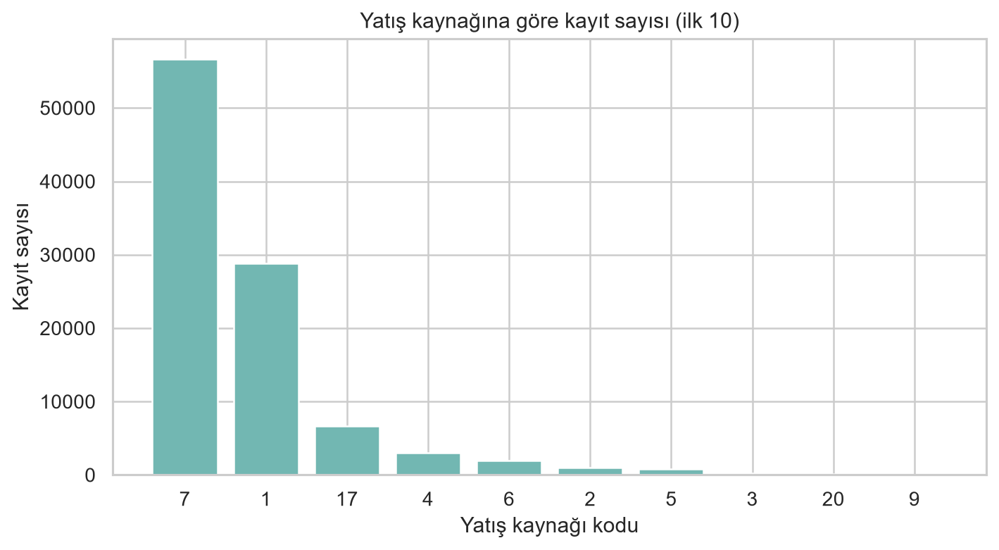

# Faz 1 Proje İlerleme Durum Raporu

**Proje:** Tablosal Veride Dağılım Kaymasına Duyarlı Güvenilirlik İzleme: Güven, Kalibrasyon, Veri Kayması ve Açıklama Sinyallerinin Erken Uyarı Performansının Karşılaştırmalı Analizi

**Grup üyeleri:** Elif Su Baydarlı (241230017), Zehra Akgül (241230036)

**Ders sorumlusu:** Dr. Öğr. Üyesi Hayri İncekara

**Rapor tarihi:** 9 Kasım 2026
**Proje alanı:** Makine öğrenmesi

## 1. Projenin tanımı ve amacı

### 1.1. Problem tanımı

Bir model kullanıma alındıktan sonra girdi verilerinin dağılımı değişebilir. Gerçek etiketler gecikmeli geldiğinde başarı düşüşü hemen ölçülemez. Bu çalışma, tablosal ikili sınıflandırma görevlerinde etiketsiz izleme sinyallerinin performans bozulmasını ne zaman gösterebildiğini ve ne sıklıkta yanlış alarm ürettiğini araştırmaktadır.

### 1.2. Projenin amacı

Amaç; girdi dağılımı, tahmin güveni, olasılık kalibrasyonu ve model açıklamalarındaki değişimi izleyen sinyalleri karşılaştırmaktır. Etiketler erişilebilir olduğunda bu sinyaller modelin Accuracy, F1 ve AUC gibi ölçümleriyle birlikte değerlendirilecektir.

### 1.3. Projenin kapsamı

Projede ABD ACS PUMS verisinden Folktables ACSIncome ve ACSEmployment görevleri ile UCI Diabetes 130-US Hospitals verisinden 30 günlük yeniden yatış görevi incelenmektedir. Bu görevler yıl, eyalet ve yatış kaynağı bağlamlarında karşılaştırılacaktır. Faz 1’de veri analizi ve ön işleme yapılmış, modeller seçilmiştir; model eğitimi ve performans deneyi henüz yapılmamıştır.

## 2. Veri setlerinin bulunması ve analizi

### 2.1. Kullanılan veri setleri

Faz 1’de iki gerçek veri kaynağından üç etiketli ikili sınıflandırma görevi kullanılmıştır. ACS görevleri 2014 ve 2018 bir yıllık ACS PUMS kişi mikroverisinden Folktables 0.0.12 ile elde edilmiştir. UCI veri seti 1999–2008 döneminde 130 ABD hastanesindeki karşılaşmaları içerir [1, 8–12]. Veri setleri yapay olarak üretilmemiştir.

- **ACSIncome:** Yıllık kişisel gelirin 50.000 ABD doları üzerinde olup olmadığını tahmin eder. Folktables görev filtresi `AGEP > 16`, `PINCP > 100`, `WKHP > 0` ve `PWGTP >= 1` koşullarını uygular. 10 girdi özelliği vardır: 2 sayısal ve 8 kategorik.
- **ACSEmployment:** Çalışıyor olma hedefi `ESR == 1` olarak tanımlanır. Folktables 0.0.12’de bu görev için ek satır filtresi uygulanmamıştır. 16 girdi özelliği vardır: 1 sayısal ve 15 kategorik.
- **Diabetes 130-US Hospitals:** Hedef, `readmitted` değeri `<30` olan kayıtların yeniden yatış pozitif sınıfı olarak belirlenmesidir. `>30` ve `NO` negatif sınıftır. UCI’deki 101.766 ham kaydın 2.273’ünde `race` eksik olduğu için bu kayıtlar çıkarılmış; 99.493 kayıt kalmıştır. Ham CSV’de 50 sütun bulunur. Kimlikler, hedef, alan değişkeni `admission_source_id` ve yüksek eksikliği nedeniyle `weight` model girdilerinden çıkarıldığında 45 girdi özelliği kalır. Bu görev TableShift’in Hospital Readmission tanımıyla uyumludur [1, 11, 12].

Folktables: https://github.com/socialfoundations/folktables

ACS PUMS: https://www.census.gov/programs-surveys/acs/microdata.html

UCI Diabetes 130-US Hospitals: https://archive.ics.uci.edu/dataset/296/diabetes+130-us-hospitals-for-years-1999-2008

### 2.2. Veri setlerinin genel özellikleri

ACS verileri California (CA) ve Michigan (MI) eyaletleri için 2014 ve 2018 yıllarında incelenmiştir. Sınıf sayıları kişi ağırlığı `PWGTP` kullanılmadan hesaplanmıştır. Bu oranlar ABD nüfusu için ağırlıklı tahmin değildir. UCI’de 99.493 kaydın 11.169’u 30 gün içinde yeniden yatış, 88.324’ü negatif sınıftır. Pozitif sınıf oranı %11,23’tür.

| İncelenen özellik | Açıklama / sonuç |
|---|---|
| Toplam veri sayısı | ACSIncome: 183.941, 47.888, 195.665 ve 50.008 görev kaydı. ACSEmployment: 372.553, 98.180, 378.817 ve 99.419 görev kaydı. UCI: 99.493 görev kaydı. |
| Eğitim verisi | 2014 CA ACSIncome: 147.152; ACSEmployment: 298.042; UCI kaynak alanı içi eğitim: 27.281 kayıt. |
| Doğrulama verisi | 2014 CA ACSIncome: 36.789; ACSEmployment: 74.511; UCI kaynak alanı içi doğrulama: 6.834 kayıt. |
| Ayrılmış değerlendirme verisi | ACS 2018 CA zamansal; MI 2014 ve 2018 coğrafi değerlendirme bağlamlarıdır. UCI’de `admission_source_id = 7` alan dışı bağlamı 56.632 kayıttır. Bu bölümlerde model sonucu henüz hesaplanmamıştır. |
| Sınıf sayısı | Üç görev de iki sınıflıdır. Sınıf sayıları aşağıdaki tabloda verilmiştir. |
| Sınıf dağılımı | ACS görevlerinde oranlar bağlama göre değişir. UCI’de pozitif sınıf 11.169, negatif sınıf 88.324’tür. |
| Eksik veri durumu | ACSIncome girdilerinde eksik değer yoktur. ACSEmployment’ta en fazla eksik değer `ESP` sütunundadır (%79,27–%81,32). UCI’de tüm kayıtlarda en az bir model girdisi eksiktir; `weight` %96,93 eksik olduğu için çıkarılmıştır. Kalan girdilerde en yüksek eksiklik `max_glu_serum` sütununda %94,68’dir. |
| Etiket durumu | Üç görev de etiketlidir. ACS hedefleri Folktables görev tanımına; UCI hedefi `readmitted` alanına dayanır. |
| Veri formatı | ACS PUMS ve UCI karşılaşma kayıtları CSV biçiminde tablosaldır. |
| Boyut / özellik | ACSIncome 10; ACSEmployment 16; UCI 45 model girdi özelliği. UCI ham CSV sütun sayısı 50’dir. |

**Bağlama göre sınıf sayıları**

| Bağlam | Görev | Pozitif sınıf | Pozitif | Negatif | Toplam |
|---|---|---|---:|---:|---:|
| 2014 CA | ACSIncome | PINCP > 50.000 USD | 65.227 | 118.714 | 183.941 |
| 2014 MI | ACSIncome | PINCP > 50.000 USD | 13.599 | 34.289 | 47.888 |
| 2018 CA | ACSIncome | PINCP > 50.000 USD | 80.335 | 115.330 | 195.665 |
| 2018 MI | ACSIncome | PINCP > 50.000 USD | 16.861 | 33.147 | 50.008 |
| 2014 CA | ACSEmployment | ESR = 1 | 160.493 | 212.060 | 372.553 |
| 2014 MI | ACSEmployment | ESR = 1 | 41.597 | 56.583 | 98.180 |
| 2018 CA | ACSEmployment | ESR = 1 | 172.803 | 206.014 | 378.817 |
| 2018 MI | ACSEmployment | ESR = 1 | 44.103 | 55.316 | 99.419 |
| UCI, 1999–2008 | Yeniden yatış | `readmitted = <30` | 11.169 | 88.324 | 99.493 |

### 2.3. Veri setinin görselleştirilmesi

Örnek sayısı ve pozitif sınıf oranı ACS yılına ve eyalete göre değişmektedir. UCI’de yeniden yatış sınıfı dengesizdir. Grafikler bu dağılımları ve incelenen eksik değerleri göstermektedir.

ACS sınıf oranındaki değişim tek başına model performansının düştüğünü göstermez. UCI’de aynı hastaya ait birden fazla karşılaşma vardır; 69.668 benzersiz hasta ve 29.825 tekrar karşılaşma kaydı bulunur. Bu nedenle veri bölmeleri hasta kimliğini koruyacak şekilde hazırlanmıştır.

### 2.4. Veri setlerinin proje için uygunluğu

ACS görevleri, farklı yıl ve eyalet bağlamlarını aynı görev tanımı içinde incelemeyi sağlar. UCI görevi ise etiketli 30 günlük yeniden yatış hedefi ve `admission_source_id` alanıyla kaynak dışı değerlendirme olanağı sunar. Görevlerin etiketli olması, ilerleyen aşamada etiketsiz izleme sinyallerini gerçek performans metrikleriyle karşılaştırmayı mümkün kılar.

UCI’de pozitif sınıf azınlıktadır ve tekrar karşılaşmalar hasta bazlı bölme gerektirir. `weight` ve bazı laboratuvar alanlarında eksiklik yüksektir. ACS sınıf oranları kişi ağırlığı kullanılmadan hesaplanmıştır. Bu sınırlılıklar raporlanan sayılar ve sonraki değerlendirme protokolüyle birlikte ele alınacaktır.

## 3. Veri ön işleme ve hazırlık

### 3.1. Uygulanan ön işleme işlemleri

Ham verilerdeki eksiklik işaretleri düzenlenmiş; özellik ve hedef sütunları ayrılmış; eğitim, doğrulama ve alan dışı bölümler hazırlanmıştır. Dönüştürücüler yalnızca eğitim verisinde fit edilmiştir.

- Folktables `-1` ve UCI `?` değerleri eksik değer olarak işlenmiştir.
- Sayısal değişkenler eğitim verisinin medyanı ile tamamlanmış ve StandardScaler ile ölçeklenmiştir.
- ACSIncome kategorik değişkenleri en sık değerle; ACSEmployment ve UCI kategorik değişkenleri ayrı `Eksik` kategorisiyle tamamlanmıştır. One-hot kodlama uygulanmıştır.
- ACSIncome ve ACSEmployment için 2014 CA görev verisi hedef sınıfı korunarak %80 eğitim ve %20 iç doğrulama olarak bölünmüştür. 2018 CA zamansal, 2014 ve 2018 MI coğrafi değerlendirme bağlamlarıdır.
- UCI’de eksik `race` nedeniyle 2.273 kayıt çıkarılmıştır. `admission_source_id = 7` alan dışı tutulmuştur. Bu alandaki hastalarla örtüşen 8.746 kaynak alanı kaydı eğitim kaynağından çıkarılmış; kalan kayıtlar hasta kimliğine göre %80/%20 eğitim-doğrulama olarak ayrılmıştır.
- UCI eğitim, iç doğrulama ve alan dışı bölümlerinde sırasıyla 27.281, 6.834 ve 56.632 kayıt vardır. Bölümler arasında hasta kimliği örtüşmesi yoktur. UCI bölmesi TableShift’in yayımlanmış resmi bölmelerinin aynısı değildir [11, 12].

### 3.2. Ön işleme öncesi ve sonrası veri seti

| Özellik | Ön işleme öncesi | Ön işleme sonrası |
|---|---|---|
| Kayıt sayısı | ACS görev sayıları bağlama göre 47.888–378.817; UCI ham 101.766 kayıt. | UCI filtre sonrası 99.493 kayıt. Eğitim matrisleri: ACSIncome 147.152, ACSEmployment 298.042, UCI 27.281 kayıt. Ayrı doğrulama ve alan dışı bölümler oluşturulmuştur. |
| Özellik boyutu | ACSIncome 10; ACSEmployment 16; UCI ham CSV 50 sütun. | One-hot sonrası ACSIncome 757, ACSEmployment 98, UCI 2.011 girdi özelliği. |
| Veri formatı | Ham CSV kayıtları. | Seyrek CSR matrisleri `.npz`, hedef etiketleri `.npy` biçiminde yerel olarak üretilmiştir. |
| Eksik veri | ACSIncome girdilerinde yok; ACSEmployment `ESP` alanı %79,27–%81,32 eksik; UCI girdilerinde eksiklik yaygındır. | Sayısal eksikler medyanla, kategorik eksikler görev kuralına göre doldurulmuştur. Dönüşüm sonrası matrislerde sonlu olmayan değer kalmamıştır. |
| Ölçekleme / kodlama | Sayısal ve kategorik alanlar kaynak kodlarıyla tutulmuştur. | Sayısal alanlar ölçeklenmiş; kategorik alanlar one-hot kodlanmıştır. Fit yalnızca eğitim verisinde yapılmıştır. |
| Etiket | ACSIncome, ACSEmployment ve `readmitted` kaynak etiketleri. | Üç görev ikili hedef olarak kaydedilmiştir; UCI `<30` pozitif, `>30` ve `NO` negatiftir. |

UCI bölümlerinde eğitim verisi 23.104 hastayı, doğrulama 5.776 hastayı ve alan dışı bölüm 40.788 hastayı içerir. ACS ve UCI dönüşüm hatları eğitim verisine fit edilmiştir. Matris ve ön işleyici dosyaları `results/phase1/preprocessed/` altında yerel olarak tutulur; ham veri ve bu büyük ara çıktılar depoya eklenmemiştir.

### 3.3. Ön işleme kodları ve çıktıları

ACS keşif kodu `src/data/phase1_eda.py`, UCI keşif kodu `src/data/phase1_readmission_eda.py`, dönüşüm adımları `src/data/preprocessing.py` ve bölme/çıktı üretimi `src/data/phase1_preprocessing.py` dosyalarındadır. Özetler `results/phase1/` ve paylaşılabilir grafikler `reports/figures/` altındadır. Ön işleme çalıştırılmış ve matrisler oluşturulmuştur; sınıflandırma modelleri henüz eğitilmemiştir.

## 4. Literatür taraması

### 4.1. İlgili akademik çalışmalar

Veri setinin kaynak makalesi Strack et al. [2] olarak ayrıca incelenmiştir. Aşağıdaki beş çalışma UCI Diabetes 130-US Hospitals verisi veya aynı 130 hastanelik 1999–2008 kayıt kaynağı üzerinde diyabet hastalarının yeniden yatışını ele alır. Veri filtresi, hedef kodlaması ve bölme yöntemi çalışmalar arasında farklıdır.

| No | Makale / çalışma | Yıl | Kullanılan veri seti | Kullanılan yöntem | Temel sonuç |
|---:|---|---:|---|---|---|
| 1 | Alloghani et al. [3] | 2019 | 130 ABD hastanesinin diyabet kayıtları; 78.363 tedavi alan kişi | LDA, Random Forest, kNN, Naive Bayes, J48 ve SVM; 70/30 ayrım, eğitimde 10 katlı doğrulama | Yeniden yatışla ilişkili klinik değişkenler ve farklı sınıflandırıcılar incelenmiştir. Filtre bu projeden farklıdır. |
| 2 | Cui et al. [4] | 2018 | Diabetes 130-US Hospitals kaynaklı 8.756 kayıt | SMOTE, özellik seçimi ve genetik algoritmayla ayarlanan SVM; beş katlı çapraz doğrulama | %81,02 doğruluk, %82,89 duyarlılık ve %79,23 özgüllük bildirilmiştir; örneklem ve protokol farklıdır. |
| 3 | Shang et al. [5] | 2021 | 130 hastanelik 1999–2008 diyabet kayıtları; ön işleme sonrası 100.244 kayıt | Random Forest, Naive Bayes ve karar ağacı topluluğu; 23 özellik | Random Forest üç yöntem arasında en yüksek ROC-AUC değerini vermiştir. Sonuç doğrudan karşılaştırılabilir değildir. |
| 4 | Liu, Sue ve Wu [6] | 2024 | UCI Diabetes 130-US Hospitals; 101.766 karşılaşma | 10 makine öğrenmesi yöntemi ve LSTM; GWO ile özellik seçimi, grup katlarında SMOTE | Yazarlar Random Forest ve XGBoost’u öne çıkarmıştır. Özet bölümündeki F1 değerleri tutarsız olduğundan sayısal sonuç kullanılmamıştır. |
| 5 | Emi-Johnson ve Nkrumah [7] | 2025 | UCI Diabetes 130-US Hospitals; 101.766 karşılaşma | Lojistik Regresyon, Random Forest, XGBoost ve derin sinir ağı; 80/20 bölme ve SHAP | XGBoost ROC-AUC 0,667; Lojistik Regresyon 0,642; Random Forest 0,630; derin sinir ağı 0,579 olarak raporlanmıştır. |

### 4.2. Kullanılan yöntemlerin analizi

İncelenen çalışmalarda lojistik regresyon, Random Forest, destek vektör makineleri, artırmalı ağaçlar ve sinir ağları kullanılmıştır. SMOTE ve özellik seçimi, sınıf dengesizliği ve değişken sayısını ele almak için kullanılan yöntemlerdir. Veri filtresi, hedef ve bölme protokolleri farklı olduğundan yayımlanan skorlar bu projenin gelecekteki sonuçlarıyla sayısal olarak karşılaştırılmayacaktır. Bu projede planlanan kalibrasyon ve etiketsiz izleme deneyleri Faz 1’de henüz yapılmamıştır.

Çalışmalar farklı hedef ve filtre tanımlarına, kayıt sayılarına ve veri bölme protokollerine sahiptir. Özellikle dengesiz sınıflarda doğruluk tek başına yeterli değildir. Bu nedenle yayımlanan skorlar bu projenin gelecekteki sonuçlarıyla doğrudan karşılaştırılmayacak; ancak aynı hedef ve benzer bölme koşulları bulunan durumlarda yöntemsel bağlamla birlikte yorumlanacaktır.

### 4.3. Literatürün genel değerlendirilmesi

Folktables, ACSIncome ve ACSEmployment görevlerini aynı veri kaynağının yıl ve eyalet örneklemlerinde tanımlar [8–10]. TableShift, UCI yeniden yatış görevinde yatış kaynağı 7’yi (acil servis) alan dışı grup olarak kullanır [11, 12]. Etiketsiz zararlı kayma tespiti ve etiket gecikmesinde performans tahmini, dağılım izleme literatüründe ele alınmıştır [13, 14]. Bu rapor Faz 1 düzeyinde bir kaynak taramasıdır; özgünlük veya literatürde ilk olma iddiası içermez.

## 5. Kullanılacak yöntem ve mimariler

### 5.1. Yöntem seçimi

Faz 1 için üç tablosal sınıflandırıcı ve bir düşük uygunluk kontrol mimarisi olmak üzere dört yöntem seçilmiştir. Böylece yönergede belirtilen 3–5 yöntem aralığı karşılanmaktadır.

| Yöntem / model | Kullanılma amacı | Seçilme nedeni |
|---|---|---|
| Lojistik Regresyon | Başlangıç sınıflandırıcısı | Yorumlanabilir ve doğrusal karşılaştırma noktası sağlar. |
| Random Forest | Doğrusal olmayan ilişkiler ve etkileşimler | Tablosal veride ağaç tabanlı karşılaştırma sağlar. |
| XGBoost | Artırmalı ağaç karşılaştırması | Tablosal sınıflandırma literatüründeki güçlü ağaç yöntemlerinden biridir. |
| 1B CNN | Düşük uygunluk kontrolü | Tablo sütunlarının doğal sırası olmadığından evrişim varsayımının etkisini sınamak için kullanılır. |

### 5.2. Seçilen mimarilerin açıklanması

Lojistik Regresyon doğrusal karar sınırı ve katsayılarıyla başlangıç karşılaştırması sağlayacaktır. Random Forest çok sayıda karar ağacının oylarını birleştirir. XGBoost ağaçları ardışık olarak ekleyip önceki hataları azaltmayı amaçlar. 1B CNN özellik dizisini evrişim katmanlarıyla işler; tablosal sütunlarda doğal komşuluk olmadığı için düşük uygunluklu kontrol modeli olarak tutulmuştur. Modellerin hiperparametreleri Faz 2’de belirlenecektir.

### 5.3. Yöntemlerin karşılaştırılması

Lojistik Regresyon yorumlanabilir bir başlangıç sunar, ancak karmaşık doğrusal olmayan ilişkileri sınırlı temsil eder. Ağaç tabanlı yöntemler doğrusal olmayan ilişkileri ve etkileşimleri yakalayabilir; sonuçların kalibrasyonu ayrıca ölçülecektir. 1B CNN’in performansı, sütun sıralama varsayımına duyarlıdır ve tablo özellikleri için uygun olmayan kontrolü temsil eder.

### 5.4. Değerlendirme metrikleri

Etiketler kullanılarak Accuracy, Precision, Recall, F1, ROC-AUC ve PR-AUC hesaplanacaktır. UCI pozitif sınıfı %11,23 olduğundan F1 ve PR-AUC özellikle raporlanacaktır; Accuracy tek başına yorumlanmayacaktır. Olasılık kalibrasyonu Brier skoru ve ECE ile değerlendirilecektir. Erken uyarı sinyalleri yanlış alarm oranı, tespit gücü ve uyarı gecikmesiyle karşılaştırılacaktır. Bu metrikler için Faz 1’de sonuç üretilmemiştir.

## 6. Faz 1 uygulama durumu ve çıktılar

| Gerçekleştirilen iş | Durum | Açıklama |
|---|---|---|
| Veri setlerinin bulunması | Kısmen tamamlandı | ACS PUMS/Folktables ve UCI kaynakları ile üç görev tanımlandı; proje önerisindeki ikinci TableShift görevi henüz seçilmedi. |
| Veri setlerinin indirilmesi | Tamamlandı | ACS 2014/2018 CA/MI dosyaları ve UCI CSV yerel çalışma alanında kullanıldı. |
| Veri analizinin yapılması | Tamamlandı | Örnek sayısı, sınıf etiketleri, eksik değerler ve veri özellikleri incelendi. |
| Veri görselleştirmeleri | Tamamlandı | Altı analiz grafiği hazırlandı. |
| Ön işleme | Tamamlandı | Eğitim verisine fit edilen dönüşümler çalıştırıldı; matrisler yerel çıktı klasöründe üretildi. |
| Literatür taraması | İlk tarama tamamlandı | Beş UCI yeniden yatış çalışması ile Folktables, TableShift ve izleme kaynakları incelendi. |
| Yöntem / mimari seçimi | Tamamlandı | Lojistik Regresyon, Random Forest, XGBoost ve düşük uygunluk kontrolü olarak 1B CNN seçildi; modeller eğitilmedi. |

Proje deposu: https://github.com/Elifsubaydarli/dagilim-kaymasi-guvenilirlik-izleme-projesi

## 7. Sonuç ve sonraki fazın planı

### 7.1. Faz 1 genel değerlendirmesi

İki veri kaynağından üç etiketli sınıflandırma görevi tanımlandı. ACS bağlamlarında ve UCI görevinde örnek sayısı, sınıf dağılımı ve eksik değer analizi yapıldı. Altı görsel hazırlandı. Veri temizleme, hasta ve bağlam ayrımı, imputasyon, ölçekleme ve one-hot dönüşümünü içeren ön işleme hattı çalıştırıldı. Dört model seçildi; model eğitimi ve izleme deneyi yapılmadı.

### 7.2. Karşılaşılan problemler

ACSEmployment görevinde `ESP` eksikliği yüksektir. UCI’de `weight` ve bazı ölçüm alanlarının eksikliği yüksektir; sınıflar dengesiz ve hasta başına karşılaşma sayısı birden fazladır. UCI için kullanılan hasta bazlı alan ayrımı resmi TableShift bölmelerini kopyalamaz. Bu nedenle raporlanan veri hazırlama sonuçları ile gelecekteki benchmark sonuçları ayrı tutulacaktır.

### 7.3. Sonraki fazın planı

Proje önerisindeki en az iki TableShift göreviyle dış doğrulama koşulu için ikinci görev henüz seçilmemiştir. ACSIncome ve ACSEmployment hedefleri TableShift Income ve Unemployment görevleriyle aynı değildir. Faz 2’de ikinci görev belirlenecek, resmi TableShift bölmeleri kullanılacak, dört model eğitilecek ve kontrollü kaymalar altında izleme sinyalleri değerlendirilecektir. Sonuçlar benzer hedef, filtre ve bölme kullanan çalışmalarla karşılaştırılacak; iki kişilik grup için finalde gerçek makale/bildiri hazırlanacaktır.

## 8. Kaynakça

1. Clore, J., Cios, K., DeShazo, J., & Strack, B. (2014). Diabetes 130-US Hospitals for Years 1999–2008 [Veri seti]. UCI Machine Learning Repository. https://doi.org/10.24432/C5230J. https://archive.ics.uci.edu/dataset/296/diabetes+130-us-hospitals-for-years-1999-2008
2. Strack, B., DeShazo, J. P., Gennings, C., Olmo, J. L., Ventura, S., Cios, K. J., & Clore, J. N. (2014). Impact of HbA1c measurement on hospital readmission rates: Analysis of 70,000 clinical database patient records. BioMed Research International, 2014, 781670. https://doi.org/10.1155/2014/781670
3. Alloghani, M., Aljaaf, A., Hussain, A., Baker, T., Mustafina, J., Al-Jumeily, D., & Khalaf, M. (2019). Implementation of machine learning algorithms to create diabetic patient re-admission profiles. BMC Medical Informatics and Decision Making, 19(Suppl 9), 253. https://doi.org/10.1186/s12911-019-0990-x
4. Cui, S., Wang, D., Wang, Y., Yu, P., & Jin, Y. (2018). An improved support vector machine-based diabetic readmission prediction. Computer Methods and Programs in Biomedicine, 166, 123–135. https://doi.org/10.1016/j.cmpb.2018.10.012
5. Shang, Y., Jiang, K., Wang, L., Zhang, Z., Zhou, S., Liu, Y., Dong, J., & Wu, H. (2021). The 30-days hospital readmission risk in diabetic patients: Predictive modeling with machine learning classifiers. BMC Medical Informatics and Decision Making, 21(Suppl 2), 57. https://doi.org/10.1186/s12911-021-01423-y
6. Liu, V. B., Sue, L. Y., & Wu, Y. (2024). Comparison of machine learning models for predicting 30-day readmission rates for patients with diabetes. Journal of Medical Artificial Intelligence, 7, 23. https://doi.org/10.21037/jmai-24-70
7. Emi-Johnson, O. G., & Nkrumah, K. J. (2025). Predicting 30-day hospital readmission in patients with diabetes using machine learning on electronic health record data. Cureus, 17(4), e82437. https://doi.org/10.7759/cureus.82437
8. Ding, F., Hardt, M., Miller, J. P., & Schmidt, L. (2021). Retiring Adult: New datasets for fair machine learning. Advances in Neural Information Processing Systems, 34. https://doi.org/10.48550/arXiv.2108.04884
9. Social Foundations Lab. (n.d.). Folktables: Datasets derived from U.S. Census data. https://github.com/socialfoundations/folktables
10. U.S. Census Bureau. (n.d.). American Community Survey Public Use Microdata Sample (ACS PUMS). https://www.census.gov/programs-surveys/acs/microdata.html
11. Gardner, J., Popovic, Z., & Schmidt, L. (2023). Benchmarking distribution shift in tabular data with TableShift. Advances in Neural Information Processing Systems, 36, Datasets and Benchmarks Track. https://doi.org/10.52202/075280-2324
12. TableShift. (n.d.). Datasets: Hospital Readmission. https://tableshift.org/datasets.html
13. Amoukou, S. I., Bewley, T., Mishra, S., Lecue, F., Magazzeni, D., & Veloso, M. (2024). Sequential harmful shift detection without labels. Advances in Neural Information Processing Systems, 37. https://doi.org/10.52202/079017-4107
14. Białek, J., Kivimäki, J., Kuberski, W., & Perrakis, N. (2025). Estimating model performance under covariate shift without labels. Advances in Neural Information Processing Systems, 38. https://doi.org/10.52202/085713-5379
